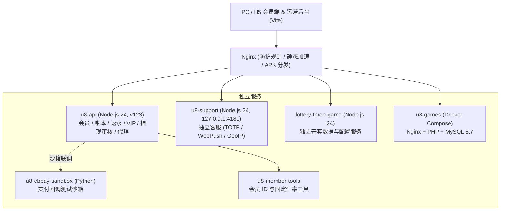

# U8 综合业务平台

> 更新日期：2026-11-23（对应主服务版本 `v123`） · [返回主页](https://github.com/leee991)

一套多服务拆分的业务平台，主站 API 用原生 Node.js 24（ESM + 内置 `node:sqlite`）写的，外围的在线客服、支付回调沙箱、公开开奖数据源和旧版游戏引擎全部按进程或容器隔离开了。

## 整体结构

## 重点做过哪些事情

1. **把主站后端拆成了 60 多个小模块（`u8-api`）**
   - 没上重型框架，直接 Node.js 24 原生 ESM + `node:sqlite`，按业务切成单一职责文件，改哪块动哪块：
   - 账本和提现：`wallet-consolidation`、`withdrawal-financials`、`withdrawal-limits`、`withdrawal-decisions`、`withdrawal-turnover-view`、`payout-bindings`
   - 定时和活动：`daily-rebate-scheduler`、`rebate-automation`、`vip-automation`、`first-deposit`
   - 安全与精度：`session-policy`、`transaction-passwords`、`report-precision`、`supplier-precision`
2. **客服系统彻底和主站物理隔离（`u8-support`）**
   - 单独起系统服务和 SQLite 文件，只听 `127.0.0.1:4181`，不读主站会员库和资金库；回滚时只切软链接，绝对不动财务数据库。
   - 带了 TOTP 双因素认证、WebPush 通知、本地 GeoIP 查询和每天凌晨 AES-GCM 加密定时备份（备份完会自动跑一次解密和 `quick_check` 校验）。
3. **写了个隔离的支付回调沙箱（`u8-ebpay-sandbox`）**
   - 联调充值和代付回调时怕误触线上钱包，用 Python 写了个本地沙箱，把成功、拒绝、查单几种状态都跑通并配上自动化测试（`test_sandbox.py`）。
4. **试玩和正式账本分开**
   - `lottery-three-game` 配合 `trial-wallet` / `test-lottery-wallet` 走不可兑现的试玩链路，测试和压测不会弄脏正式账目。

## 目录说明

- `docs/ARCHITECTURE.md`：服务隔离方式、提现审核链路和测试说明
- `docs/API_CONTRACT.md`：主服务、客服和沙箱的主要接口
- `config/`：Nginx 防护/缓存配置、游戏容器 Compose 模板和 `.env.example`
- `skeleton/`：后端核心 `.mjs`、客服、支付沙箱的模块签名骨架
- `DIRECTORY_TREE.txt`：代码目录树统计
