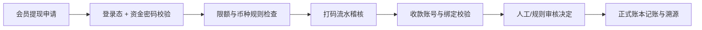

# 架构与模块划分 — U8 平台

## 1. 为什么要拆成这么多小服务？

最开始所有东西耦在一起，改个客服页面或者测个支付回调都担心影响会员账本。所以后面定了个规矩：**碰钱的主库不动，外围高变更的东西全拆出去单独跑**。

- **`u8-api`**：只管会员、账本、充提、打码流水、返水批处理、VIP 和代理。
- **`u8-support`**：独立进程 + 独立 SQLite + 独立 Cookie，访客和坐席会话不走主站登录态，哪怕客服升级回滚也不碰主库。
- **`u8-ebpay-sandbox`**：专门模拟外部支付渠道的创建、查单和异步回调，无生产钱包权限。
- **`u8-games`**：老的 PHP 游戏引擎和 MySQL 5.7 关在独立的 Docker Compose 里，跟宿主机的 Node 服务互不干扰。

## 2. 提现审核走过的几道关

## 3. 自动化检查
- 供应商只读探测：`tests/neapi-integration.test.mjs`
- 客服权限与隔离单测：`tests/migration.test.js`（覆盖空白初始化、CSRF、访客隔离、图片归属权）
- 支付沙箱流程测试：`tests/test_sandbox.py`
